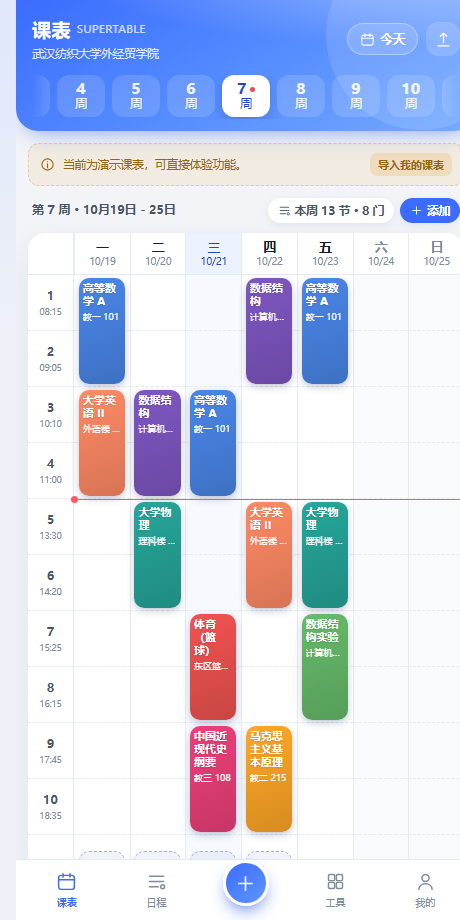
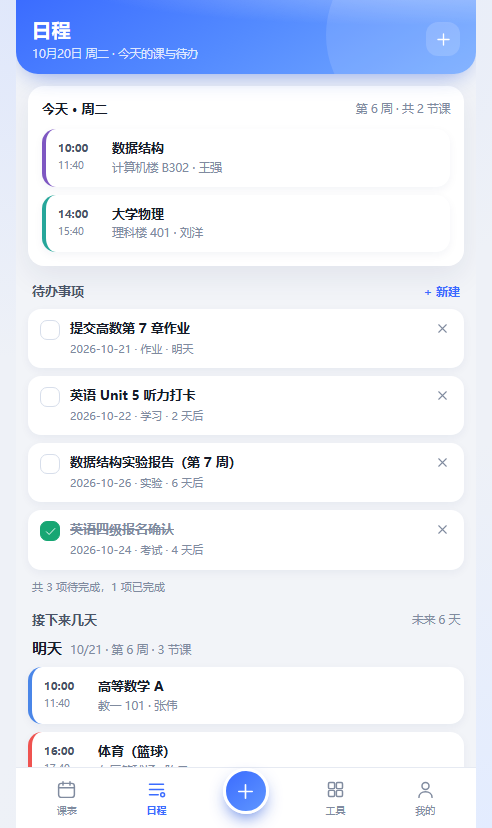
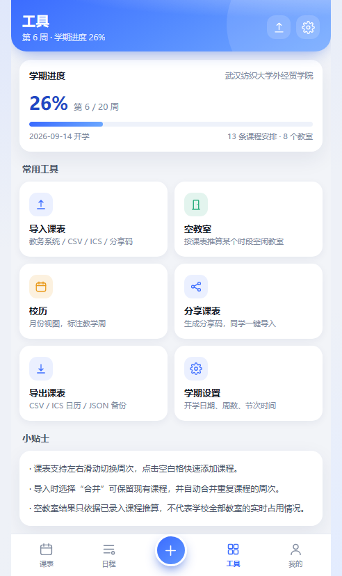
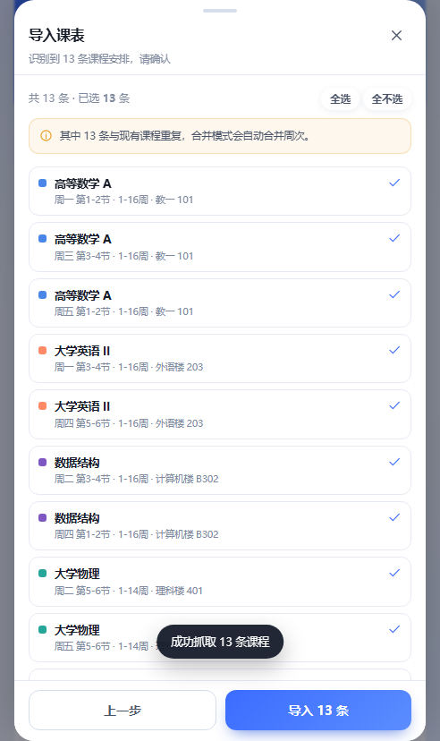
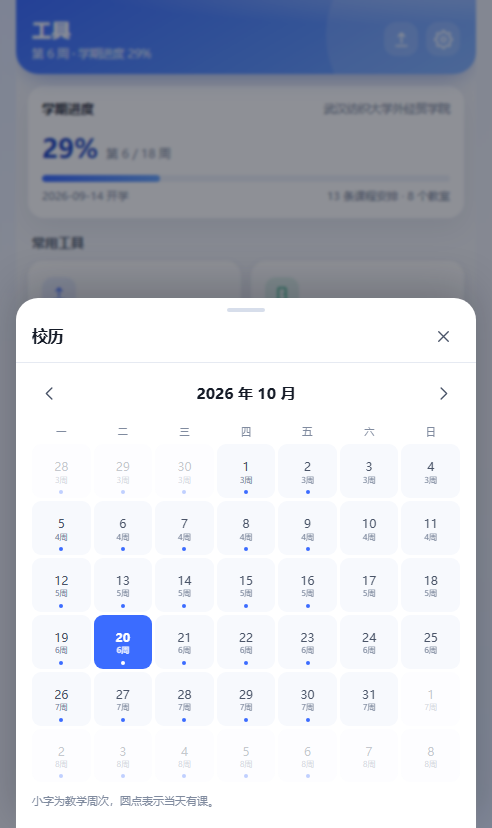
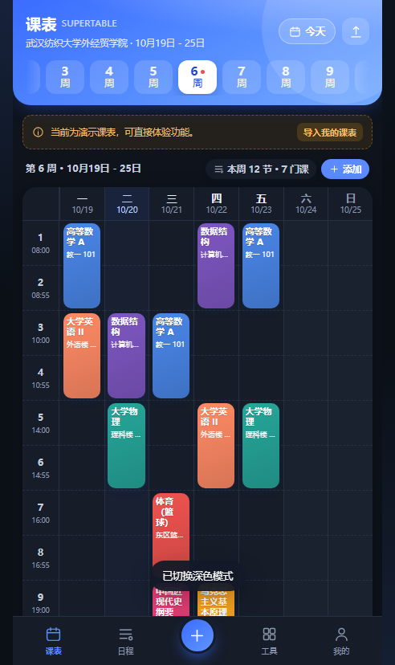
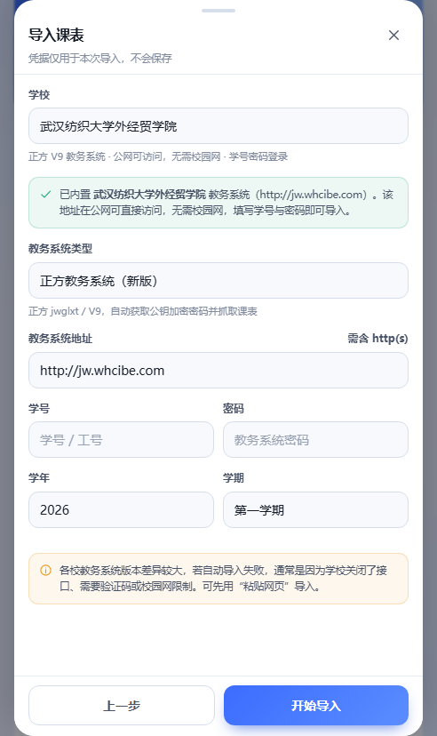
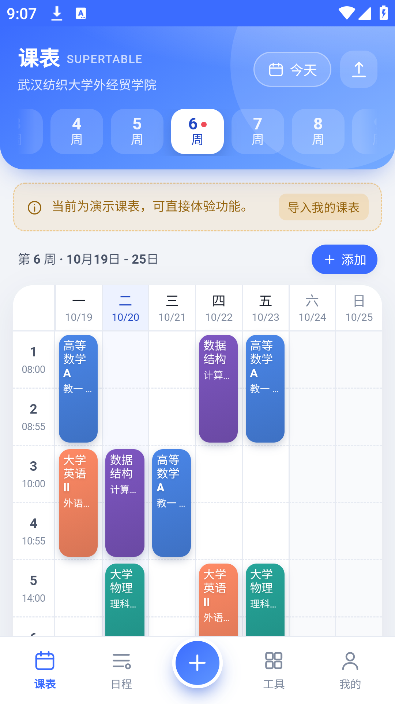

# 无广课程表 SuperTable

一个自己写的手机课表 App，版本 **3.2.3**。周课表、日程待办、教务系统导入、空教室、校历、分享码都在里面。

名字就是我的需求：不要开屏广告，不要"猜你喜欢"，不要一堆推送。打开就是课表，看完就能关。

界面是照着国内课表 App 的使用习惯做的（顶部周次条、彩色课程块、底部五栏），代码和图标都是自己画的，没拿任何第三方 App 的素材。

<p align="center">
  
  
  
</p>

## 装了之后是什么样

第一次打开是**空课表**，不带任何示例课程——别人的课表看着热闹，对你没用。导入本学期的课之后按周翻。

- 周课表 20 周（可在学期设置里改成 16–24），横向周次条、左右滑动切周、一键回本周，今天高亮、当前时间一条红线，时间重叠的课自动分成两栏，点空白格可以直接加课。
- 课程字段有课程名、老师、地点、星期、节次、周次（单双周和任意周次组合都行）、颜色、备注，加的时候实时提示冲突。
- 日程页是今天的课程时间轴（含晚自习）+ 待办清单 + 未来六天的课。
- 工具页：空教室推算、校历（教学周 + 有课标记）、分享码、CSV / ICS / JSON 导出和备份恢复。
- 还有深色模式、上课提醒（Android 系统通知；网页端走浏览器通知）、PWA 离线可用。数据全部在本地 localStorage，键名 `supertable.state.v1`。

<p align="center">
  
  
  
</p>

## 跑起来

要 **Node.js 20 以上**（用了内置 `fetch`、`AbortSignal.timeout`、`getSetCookie`）。

Windows 上最省事的是双击应用目录里的 `一键启动课表.bat`，或者 `desktop\课表SuperTable.exe`。它会自己起本地服务，然后用独立应用窗口打开课表。

命令行：

```bash
cd super-timetable-github
npm start            # 等价于 node server/index.js
# 浏览器打开 http://127.0.0.1:5178
```

换端口：`PORT=8080 npm start`，PowerShell 里写 `$env:PORT=8080; npm start`。

只看看课表、不需要账号导入的话，随便一个静态服务器也行（`python -m http.server 8000` 这种）。但**别直接双击 `index.html`**，`file://` 下浏览器的 ES module 会被拦掉。静态方式下"账号导入"用不了，粘贴、文件、分享码导入照样能用。

## 武汉纺织大学外经贸学院（已适配）

学校的正方 V9 我直接做成了预设，选学校 + 学号密码就能导：

| 项目 | 值 |
| --- | --- |
| 教务系统 | 正方 V9 教学管理信息服务平台 |
| 地址 | `http://jw.whcibe.com` |
| 登录页 | `/xtgl/login_slogin.html`（RSA + Base64 公钥） |
| 课表接口 | `/kbcx/xskbcx_cxXsgrkb.html?gnmkdm=N2151` |
| 网络 | 公网能访问，不用校园网 |

校历和作息也按学校内置了：

- 第 1 周周一 = 2026-09-07（2026-09-10 周四进校），所以 2026-10-21 是第 7 周。
- 一天 10 节，每节 45 分钟：

| 节次 | 时间 | 节次 | 时间 |
| --- | --- | --- | --- |
| 第 1 节 | 08:15 - 09:00 | 第 6 节 | 14:20 - 15:05 |
| 第 2 节 | 09:05 - 09:50 | 第 7 节 | 15:25 - 16:10 |
| 第 3 节 | 10:10 - 10:55 | 第 8 节 | 16:15 - 17:00 |
| 第 4 节 | 11:00 - 11:45 | 第 9 节 | 17:45 - 18:30 |
| 第 5 节 | 13:30 - 14:15 | 第 10 节 | 18:35 - 19:20 |

- 晚自习默认周一到周四 19:30 - 21:30，名字和显示内容在「我的 → 学期设置」里能改。课表上和上课时间撞了显示课程，没撞才显示晚自习。

登录链路我自己跑过：服务能拿到登录页、取到公钥、加密后提交，账号错了学校会原样返回「用户名或密码不正确，请重新输入！」，导入向导里也能看到这句话，说明加密和登录这一段是通的。课表本身是个人数据，第一次导入得用你自己的学号密码，导之前能逐条预览。

如果哪天学校升级把接口改了，在导入向导里换成「粘贴课表网页」：登录教务系统，`Ctrl+U` 看源码，全选复制粘进去就能解析；也可以在开发者工具里找到课表接口返回的 JSON，直接粘贴导入。

<p align="center">
  
</p>

## 怎么把课导进来

入口有三个：课表页右上角的 ⤒、「我的 → 导入课表」、「工具 → 导入课表」。

**1. 网页登录导入（Android 推荐）**

App 里点「网页登录导入」，用内置浏览器打开教务系统，你自己输学号密码登录（或扫码），密码不经过 App 保存。进到课表查询页，点页面下面的「导入当前课表」就行。App 先读当前页面已经渲染出来的表格，页面结构特殊的话，会拿 WebView 的登录 Cookie 调学校课表接口兜底。导入后先预览，再选合并或覆盖。

电脑上的网页版没有内置浏览器，用「账号导入」，或者登录后复制源码用「粘贴课表网页」。

**2. 正方账号导入**

| 版本 | 地址示例 | 说明 |
| --- | --- | --- |
| 新版（jwglxt / V9） | `http://jw.whcibe.com` | 自动取 RSA 公钥（Base64 或十六进制）加密密码，登录后调 `kbcx/xskbcx_cxXsgrkb.html`，兼容 `sjkList` 实践课 |
| 旧版（ASP.NET） | `https://jw.example.edu.cn` | 解析 `__VIEWSTATE` 登录，抓 `xskbcx.aspx`，支持验证码图片 |

流程：选学校（或填系统类型和地址）→ 学号、密码、学年学期 → 开始导入 → 要验证码就输图片验证码 → 预览 → 合并或覆盖。

各校部署差别很大，接口路径、要不要教学评价、限不限校园网、有没有双因素，都可能不一样。自动导入失败时，点错误提示下面的「改用粘贴课表网页」，或者自己登录后复制源码。适配器是拿不到学校账号的情况下写的，以你们学校实际系统为准。

**3. 自定义 JSON 接口**

给一个返回 JSON 的 URL（Cookie 可选），下面两种形状都认，也能直接写中文键名 `课程名称 / 教师 / 地点 / 星期 / 节次 / 周次`：

```json
{ "kbList": [ { "kcmc": "高等数学", "xm": "张伟", "cdmc": "教一101",
  "xqj": "1", "jcs": "1-2节", "zcd": "1-16周" } ] }
```

```json
{ "data": [ { "courseName": "大学物理", "teacherName": "刘洋",
  "classroomName": "理科楼401", "dayOfWeek": 2,
  "classTime": "5-6节", "weekDescription": "1-14周" } ] }
```

**4. 兜底：粘贴 / 文件 / 分享码**

- 粘贴课表网页：登录教务系统，课表页 `Ctrl+U`，全选复制粘贴，解析器认「星期 × 节次」表格，也认列表式表格。
- CSV：表头 `课程名,教师,教室,星期,节次,周次,备注`。星期写 `周一 / 星期一 / 1` 都行，节次 `1-2节` 或 `第1-2节`，周次 `1-16周`、`1-15周(单)`、`1-8,10-16周`。
- ICS：本应用导出的日历文件，带周次和节次描述。
- 分享码：`ST1.` 开头的一串，同学在「分享码导入」里粘一下就好，不含账号信息。

## 当 App 用

### Android

安装包在 **[dist/课表SuperTable.apk](dist/课表SuperTable.apk)**，约 1.3 MB，minSdk 26 / targetSdk 34。
便携包（APK + 安装说明）在 **[dist/课表SuperTable-Android.zip](dist/课表SuperTable-Android.zip)**。

APK 是独立跑的：页面、静态资源、教务系统代理都打包在里面，不用电脑、不用 Node.js。本地代理起在 App 内部 `127.0.0.1` 的随机端口，账号密码只在一次导入里用，不落盘。文件导入走系统文件选择器，支持分享码、CSV/ICS，导出写到手机的"下载"目录。返回键先关弹层、再回课表、最后才退出。

<p align="center">
  
</p>

vivo / OriginOS 装的时候大概是这样：

1. 把 `课表SuperTable.apk` 传到手机（数据线、微信文件传输、网盘都行）。
2. 设置 → 应用与权限 → 特殊应用权限 → 安装未知应用，允许文件管理或浏览器装应用。
3. 点 APK 安装，出现"未知来源"或 Play 保护提示就选「仍要安装 / 继续」。
4. 打开「课表 SuperTable」，「我的 → 导入课表」，选「网页登录导入」（App 内登录后一键导入）或「账号导入」。

自己编译的话：

```powershell
# 需要 JDK 17 + Android SDK（platforms;android-34、build-tools;34.0.0）
cd android
$env:JAVA_HOME = "C:\Program Files\Java\jdk-17"
$env:ANDROID_SDK_ROOT = "E:\AndroidSdk"
powershell -ExecutionPolicy Bypass -File .\build.ps1
```

签名用的是我本地 keystore，不进仓库（升级安装记得用同一个）。

APK 上做过的防护：R8 混淆、Web 资源 AES-256-GCM 加密、运行时签名校验和调试检测，外面又套了一层 XopProtector 0.6.26（DEX 加密 + 原生壳）。壳只带了 arm64-v8a / armeabi-v7a，x86 模拟器上得把 RASP 关掉才起得来，参数和产物都记在 [PROTECT.md](PROTECT.md)。这些东西只是把逆向和二次打包的成本抬高，指望它"绝对破不了"是不现实的。

在 Android 9 模拟器上实测过：启动、课表渲染、导入向导、真实学校登录的错误提示、模拟成功后的导入预览、返回键关弹层，都正常。vivo X300 Ultra 是 Android 16，WebView 和网络栈一样。课表抓取还是得用本人账号走第一次。

### Windows 桌面

`desktop/课表SuperTable.exe` 是个启动器：双击起本地服务，然后用 Edge / Chrome 的应用窗口打开课表，任务栏有独立图标和标题。

- 第一次用建议跑 `desktop/安装到桌面.bat`，桌面会多一个带图标的快捷方式。
- 要 Node.js 20+（启动器会自己找 `node.exe`，也可以把 `node.exe` 塞进 `desktop/runtime/` 一起带走）。
- `desktop/停止课表.bat` 停服务，`desktop/启动课表.bat` 是命令行版启动。
- 便携包：`dist/课表SuperTable-win.zip`，解压直接跑 `desktop/课表SuperTable.exe`。

### 手机 / 平板 PWA

浏览器打开 → 菜单 → 「安装应用 / 添加到主屏幕」，全屏用起来和 App 差不多。应用内「我的 → 安装到桌面 / 手机」会把当前平台的安装步骤列出来。

手机用电脑上的教务导入时，得能访问到电脑：电脑上 `HOST=0.0.0.0 npm start`（PowerShell：`$env:HOST='0.0.0.0'; npm start`），手机开 `http://电脑局域网IP:5178` 再装到主屏幕。这时候账号密码会经局域网发到电脑上的本地服务、再转发给学校，只在可信网络里这么干；光看课表不用开局域网。

## 数据放哪

- 课表、待办、设置都在浏览器 `localStorage`（`supertable.state.v1`），不往任何第三方服务器送。
- 教务账号密码只在一次导入请求里用，存在内存会话中，**不写磁盘、不写日志**，会话 10 分钟过期。
- 导入服务只向你自己填的教务地址发请求，学校系统的使用条款自己确认。
- 公共电脑上用完，「我的 → 清空课表」再把站点数据清一下。

## 代码长什么样

```
super-timetable-github/
├── index.html                 单页应用外壳
├── css/style.css              全部样式（移动优先 + 深色）
├── js/
│   ├── app.js                 入口：路由、顶栏、底部导航、提醒
│   ├── schedule.js            周次 / 节次 / 日期 / 冲突 / 布局（纯函数）
│   ├── importers.js           JSON / CSV / ICS / 分享码的解析与导出（纯函数）
│   ├── zf-html.js             教务课表网页解析（DOMParser）
│   ├── store.js               localStorage 状态和业务动作
│   ├── ui.js                  图标、弹层、确认框、Toast
│   ├── install.js             PWA 安装支持
│   └── views/                 timetable / detail / editor / agenda / tools / me / import
├── server/
│   ├── index.js               静态站点 + /api/import 代理
│   ├── api.js                 会话管理、适配器调度
│   ├── adapters/              zfsoft / zfsoft-old / custom
│   └── lib/                   Cookie 罐、RSA 公钥加密（Base64 / Hex 都兼容）
├── desktop/                   Windows 启动器、图标、快捷方式脚本
├── test/                      单元测试（Node 内置 test runner）
├── scripts/                   CDP 端到端脚本（开发用）
└── manifest.webmanifest, sw.js, icons/
```

纯函数都在 `schedule.js` / `importers.js` 里，UI 只负责渲染，所以测试好写。

## 开发 & 测试

```bash
npm test                          # 25 个单元测试：周次、节次、冲突、车道布局、JSON/CSV/ICS/分享码、RSA（Hex/Base64）、导入会话
node scripts/check-modules.mjs    # 检查前端模块能不能正确链接
```

端到端用 CDP 驱动真实页面，服务先起好，Edge/Chrome 带 `--remote-debugging-port=9333` 启动：

```bash
node scripts/e2e.mjs      # 加课 / 改课 / 删课、学期设置、深色模式、工具弹层、CSV 导入、切周
node scripts/ui-shots.mjs # 生成各页面截图
```

## 一些坑

- 教务适配器是尽力而为的：不同学校、不同年份的系统版本都可能不一样，不保证开箱即用。失败就用粘贴网页 / CSV / 分享码。
- 武汉纺织大学外经贸学院这条我实测了登录，课表抓取还是要用本人账号走一遍；学校要是改了接口或者加了教学评价，导入向导里换粘贴网页。
- 没有成绩查询、考场查询、校园资讯这些要额外接口的东西，也没做桌面小组件。
- 空教室是按已导入的课推出来的，不代表学校全部教室的实时占用。
- 分享码就是明文 Base64，只适合同学之间传课表，别往里塞敏感信息。
- 和「超级课程表」之类的商业 App 没有任何关系，没用它们的商标、图标和代码。

## License

MIT。示例数据和文案随便改。

Built by Luoz1337
